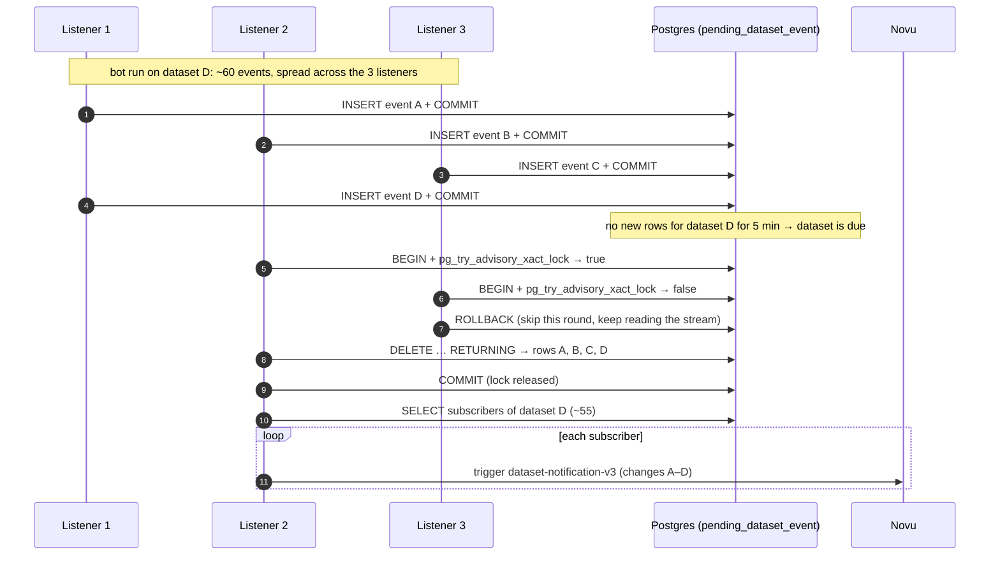
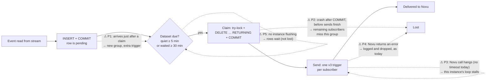

# Plan: aggregate dataset notifications per update run

*Status: draft for discussion. It implements "Option A" from the Novu event-volume analysis (measurements from Novu prod, 2026-10-05/06).*

## Context

Novu bills per workflow run, meaning one trigger for one subscriber. Novu events rose 10–14× since August 2026 (1,126 → 15,875 a day). The listener triggers Novu **once per resource event per subscriber**, and multi-resource datasets maintained by automated uploaders (bots) produce up to ~60 resource events per update, plus 2 updates per bot run.

Goal: send **one Novu trigger per subscriber per dataset update run**, carrying the list of changes. Every change still reaches the subscriber, delayed only by a few minutes on top of Novu's existing 2h delay. Estimated saving: −84% on 2026-10-04 and −92% on 2026-09-08.

Decisions:
- Option A only; no throttle (see Alternatives).
- Debounce per `dataset_id`.
- Buffer in **Postgres**.
- Send to a **new Novu workflow** whose ID is set in config, rolled out behind a flag.

The service has two independent entry points. They run as separate processes and never call each other:
- **`run.py`, the listener:** reads HDX events from the Redis stream and triggers Novu notifications.
- **`sync.py`, the subscription sync:** copies user subscriptions from CKAN into the platform's Postgres tables (`object`, `dataset`, `subscription`).

They only share library code (`common/`, `config/`) and the Postgres database: the listener reads the subscriptions that sync writes. **This plan changes only the listener. `sync.py` is untouched.**

Facts from the code and deployment that shape the design:
- **Prod runs 3 listener instances in one Redis consumer group.** Each instance reads the next message (`XREADGROUP`, `count=1`), so the events from a single dataset update are **spread across all 3 instances**. Grouping needs a buffer shared by all instances, and flushing must be coordinated so that each event is sent once.
- `hdx_redis_lib` 0.3.3 `RedisEventBus.read_event` reads with `noack=True` and `xack`s **before** processing, so delivery is already at-most-once. Delaying the ack is not possible.
- `hdx_listen` blocks up to 120s per read and only calls back when an event arrives, so it has no hook for timer-based flushes.
- `db_session()` (`common/db_utils.py`) is a process-wide singleton and is not thread-safe. A background flush thread is therefore a bad fit; use a single-threaded loop instead.
- Novu calls in `listener_processing/novu.py` use `requests.request(...)` **without a timeout**, so one hung call blocks that listener forever.
- Tables are created by `init_db()` → `Base.metadata.create_all`. It is idempotent and creates missing tables. Today only `sync.py` calls it; the listener (`run.py`) never does.
- Tests run against real Postgres; CI provides the service. `conftest.py` creates every table from `Base.metadata`.

## Design overview

```
stream event ─► process() ─► _handle_dataset_event
                               ├─ enabled-objects / skip-list / is_notification_worthy  (unchanged)
                               ├─ no subscribers → skip                                 (unchanged)
                               ├─ flag OFF → legacy per-event trigger to v2             (unchanged)
                               └─ flag ON  → INSERT into pending_dataset_event; COMMIT
listener loop, every ≤120s, on each of the 3 instances ─► flush_due_dataset_events()
      1. claim  (one short transaction: flush-lock try + one DELETE … RETURNING; COMMIT)
      2. send   (no transaction: per claimed dataset → subscribers → one v3 trigger each)
```

## Buffer table: `pending_dataset_event`

Events wait in this table between being read from the stream and being flushed to Novu. It is a **queue, not a history**:
- a row exists only from insert to claim, which is normally 5–30 minutes;
- the flush deletes the rows it claims, so the table is usually close to empty;
- at peak it holds a few hundred rows, e.g. one bot run on a ~60-resource dataset × 3 event types × 2 updates.

It lives in the platform's own Postgres database next to `object`, `dataset` and `subscription`, and is defined as a SQLAlchemy model in `common/model.py`. The equivalent DDL:

```sql
CREATE TABLE pending_dataset_event (
    id          BIGSERIAL   PRIMARY KEY,
    dataset_id  TEXT        NOT NULL,
    event       JSONB       NOT NULL,
    received_at TIMESTAMPTZ NOT NULL DEFAULT now()
);

CREATE INDEX ix_pending_dataset_event_dataset_id_received_at
    ON pending_dataset_event (dataset_id, received_at);
```

| Column | Set by | Purpose |
|---|---|---|
| `id` | Postgres sequence | Primary key only. It is **not** event order: the 3 listeners insert in parallel. |
| `dataset_id` | Listener, from `event['dataset_id']` | The grouping key: all pending rows with the same `dataset_id` are sent as one notification. |
| `event` | Listener | The full event dict exactly as read from the stream (`event_type`, `event_time`, `resource_id`, `resource_name`, `changed_fields`, dataset and org fields, …). It is stored unchanged, so the payload is built entirely at flush time, and the payload can later gain fields without a schema change. |
| `received_at` | Postgres `now()` at insert | When the platform stored the event, **not** when HDX produced it (that is `event->>'event_time'`). Drives the debounce: a dataset is due when `max(received_at)` is ≥ the quiet period ago, or `min(received_at)` is ≥ the max wait ago. The database clock avoids skew between the 3 containers. |

Index: `(dataset_id, received_at)` serves the claim's `GROUP BY dataset_id … HAVING max/min(received_at)` and the delete by `dataset_id`.

Deliberately left out:
- **No foreign key to `object`:** the `sync.py` process may delete a dataset's `object` row while events are pending, and that must not block or cascade into the buffer. Subscribers are looked up again at flush time.
- **No unique constraint:** the same resource can legitimately appear several times in one run (e.g. a bot's 2 updates). Duplicates are removed when the payload is built (`build_changes`), not at insert.
- **No status column** (`pending`/`sent`): claiming deletes the rows, so there is no state to update and nothing to clean up.

Example: the table during a bot run, with rows inserted by different listeners. `event` is abbreviated.

| id | dataset_id | received_at | event (abbreviated) |
|---:|---|---|---|
| 1041 | `a1b2…` (example-dataset) | 2026-10-04 08:00:03.112+00 | `{"event_type": "resource-deleted", "event_time": "2026-10-04T08:00:01.501234", "resource_name": "points.geojson", …}` |
| 1043 | `a1b2…` (example-dataset) | 2026-10-04 08:00:03.140+00 | `{"event_type": "resource-created", "event_time": "2026-10-04T08:00:01.501234", …}` |
| 1042 | `a1b2…` (example-dataset) | 2026-10-04 08:00:03.151+00 | `{"event_type": "resource-data-changed", "event_time": "2026-10-04T08:00:01.501234", "changed_fields": [{"field": "last_modified", …}], …}` |
| 1050 | `a1b2…` (example-dataset) | 2026-10-04 08:00:09.874+00 | `{"event_type": "resource-data-changed", "event_time": "2026-10-04T08:00:08.020511", …}` (a bot's 2nd update) |
| 1051 | `c3d4…` (another dataset) | 2026-10-04 08:01:30.002+00 | `{"event_type": "spreadsheet-sheet-changed", …}` |

Row lifecycle:
1. **Insert.** A listener reads an event. If it passes the existing checks and the dataset has subscribers, the listener inserts it and commits.
2. **Wait.** The row stays until its dataset is due. In the example, `a1b2…` becomes due at about 08:05:10, 5 minutes after its latest row (1050).
3. **Claim.** One flush deletes all of that dataset's rows (`DELETE … RETURNING`) and commits.
4. **Send.** The claimed rows are turned into one payload per subscriber. They no longer exist in the table.

## Concurrency model

The design rests on three rules:
1. **Inserts are independent.** Each instance inserts each buffered event in its own short transaction. Inserts never conflict with each other or with a flush.
2. **One claimer at a time.** A flush starts by taking the **flush lock**: a transaction-scoped advisory lock on one fixed key, `pg_try_advisory_xact_lock(FLUSH_LOCK_KEY)`, shared by all 3 instances. An instance that doesn't get it skips this round; it does not wait. The lock blocks nothing but other flushes (see [Why an advisory lock rather than a table lock](#why-an-advisory-lock-rather-than-a-table-lock)).
3. **Claim with one statement, commit, then send.** The claim is a single `DELETE … RETURNING` that both decides which datasets are due and removes their rows. It commits immediately, which also releases the lock. The Novu calls happen afterwards, outside any transaction.

### The claim

```sql
BEGIN;
SELECT pg_try_advisory_xact_lock(:flush_lock_key);        -- false → ROLLBACK; skip this round
DELETE FROM pending_dataset_event
 WHERE dataset_id IN (
       SELECT dataset_id
         FROM pending_dataset_event
        GROUP BY dataset_id
       HAVING max(received_at) <= now() - make_interval(secs => :quiet_period_s)   -- went quiet
           OR min(received_at) <= now() - make_interval(secs => :max_wait_s))      -- waited too long
RETURNING id, dataset_id, event, received_at;
COMMIT;                                                    -- rows gone, lock released
```

Why each piece is there:

| Piece | What it buys | What it would cost without it |
|---|---|---|
| Flush-lock try | Only one instance runs the `DELETE` at a time, so no partial group is split between two claimers and no deadlock can happen between them. No per-dataset locks or re-checks are needed. | Two concurrent `DELETE`s on the same rows block or deadlock, or with `SKIP LOCKED` split a group in two. |
| Try, not wait | A busy lock means another instance is already flushing, so this one carries on reading events. | Instances queue on the lock and stall their read loops. |
| One statement | The due check and the delete see the same snapshot. Rows committed after the statement starts are invisible to it and stay for the next group. | A separate `SELECT` then `DELETE` needs a re-check for rows that arrived in between. |
| `now()` from Postgres on both sides | `received_at` (column default) and the due check use one clock, so there is no skew between the 3 containers. | Clock skew between containers shifts quiet periods. |
| Commit before sending | The lock and the transaction last milliseconds. A slow or hung Novu never holds Postgres resources or blocks other flushers. | See [Why the Novu calls happen after the commit](#why-the-novu-calls-happen-after-the-commit). |

Throughput is not a concern: the lock is held for one indexed `DELETE`. With 3 instances each trying every ≤120s, some instance runs a claim about every 40s. A dataset is therefore sent up to ~2 minutes after it becomes due, which is negligible next to Novu's 2h delay.

### Why an advisory lock rather than a table lock

An advisory lock is a **named mutex**: an integer key in Postgres's lock manager. It doesn't lock the database, any table or any row. The only thing it blocks is another session asking for the same key, and only this flush code uses that key. It is narrower than a table lock, not wider: the key is merely unique within the database.

A table lock can also serialize the claimers. The weakest mode that conflicts with itself but not with the listeners' `INSERT`s is `LOCK TABLE pending_dataset_event IN SHARE UPDATE EXCLUSIVE MODE NOWAIT`. It is a worse fit for three reasons:
- **It means "maintenance" to Postgres, not "flush in progress".** `VACUUM`/autovacuum, `ANALYZE`, `CREATE INDEX CONCURRENTLY` and some `ALTER TABLE`s take the same mode. This queue table is rewritten constantly, so autovacuum visits it often. Flushes would then skip rounds while autovacuum runs, and autovacuum would wait while a flush runs.
- **Any stronger mode blocks the inserts.** `SHARE ROW EXCLUSIVE` or `EXCLUSIVE` conflict with the `ROW EXCLUSIVE` lock every `INSERT` takes, so all 3 listeners would pause their ingestion during each claim.
- **"Busy" is an error, not an answer.** `LOCK TABLE … NOWAIT` raises an error that aborts the transaction, which has to be caught and rolled back. `pg_try_advisory_xact_lock` simply returns `false`.

The one advantage of a table lock is that it is self-describing, with no arbitrary key. A named constant (`FLUSH_LOCK_KEY`) and a comment give the same clarity.

### Why the Novu calls happen after the commit

The alternative is to claim, send to every subscriber, and only then commit. The idea is that a crash mid-send rolls back the delete, so the rows come back and are sent again. That looks safer, but it doesn't deliver what it promises, and it creates new problems:

1. **It trades lost notifications for duplicate ones; it doesn't remove either.**
   - The HTTP calls to Novu are not part of the database transaction. A rollback can't undo the triggers already sent.
   - If the instance crashes after triggering 30 of 55 subscribers, the rows come back and the next flush triggers all 55 again: 30 subscribers get the group twice.
   - The same happens if every send succeeds but the `COMMIT` itself fails, e.g. on a dropped connection: all 55 are triggered twice.
   - Every duplicate is a billed Novu workflow run, which is exactly what this work is trying to cut.
2. **It doesn't help with Novu errors either.** `push_*` in `novu.py` logs and swallows HTTP errors, so a failed trigger doesn't raise and the transaction commits anyway. Retrying failed triggers would need extra code either way.
3. **It would hold the flush lock for the whole send.**
   - The flush lock is released at commit, so while one instance makes its HTTP calls, the other two can't flush anything.
   - The send takes ~55 calls per due dataset, and possibly several datasets per claim: seconds, sometimes minutes.
   - All due groups queue behind it, so notifications to unrelated datasets are delayed.
4. **One hung Novu call would stop flushing everywhere.**
   - Today the calls have no timeout. Even with the `timeout=(10, 60)` now added, 55 slow calls add up to minutes.
   - During that time the transaction stays open and keeps the lock, so no instance can flush.
5. **Long-open transactions are bad for the whole database.**
   - An open transaction stops Postgres from cleaning up dead rows (vacuum), not only in this table, which is rewritten constantly, but across the database. That includes the `subscription` tables that `sync.py` updates.
   - It also keeps a connection busy and idle in transaction for the duration.
6. **The end-to-end guarantee is at-most-once anyway.** `hdx_redis_lib` acks every stream message before the listener processes it, so a crash at the wrong moment already loses events today. Making only the flush at-least-once would not change the guarantee of the whole pipeline.

So the flush commits first and sends afterwards. The cost is pain point P2: a crash in the middle of a send loses that group for the subscribers not yet triggered. That window is a few seconds, and it is the same kind of risk the stream already carries.

### Diagram: normal flow across the 3 instances



### Diagram: life of one buffered event, with pain points



### Pain points

| # | Where | What happens | Impact | Mitigation |
|---|---|---|---|---|
| P1 | Between insert and claim | An event belonging to the same run is committed after the claim statement started, e.g. the run paused for more than the quiet period, ran longer than the max wait, or a listener lagged. It starts a new group. | **Cost only**: an extra trigger, never a duplicate or loss. | A 5 min quiet period is far longer than the gaps inside a run (< 1 min on Oct 4). Tune `DATASET_EVENT_QUIET_PERIOD_SECONDS` if logs show splits. |
| P2 | After the claim's COMMIT | The instance crashes while sending. Rows are already deleted, so subscribers not yet triggered miss this group. | **Loss**, limited to the seconds a send takes. This is the same class of risk as today: the stream already acks before processing. | Accepted. Sending inside the transaction would turn this loss into duplicates and cause other problems; see [Why the Novu calls happen after the commit](#why-the-novu-calls-happen-after-the-commit). |
| P3 | During sends | A Novu call hangs. There is no timeout today. | That instance stops reading and flushing. The lock is already released, so the other 2 keep flushing. | **Add `timeout=(10, 60)`** to all Novu requests (Changes §6). |
| P4 | During sends | Novu returns an error. | The subscriber misses that group. The error is logged, as today. | Unchanged from today. A retry can be added later if needed. |
| P5 | Waiting | All instances are down or the flush keeps failing. | Rows accumulate and are **not lost**; they flush when an instance recovers. After a long outage the first claim may return many rows. | Log the pending row count and the age of the oldest row on each flush. |
| P6 | Startup | 3 instances call `create_all` at once on a deploy and race on table creation. | A startup error. | Run `create_all` inside a transaction that holds `pg_advisory_xact_lock(INIT_LOCK_KEY)` (Changes §7). |

Only transaction-scoped advisory locks are used, so the design also works behind a transaction-pooling proxy such as PgBouncer.

## Novu payload: today vs. after

### What the email template actually reads

The templates Novu uses are in [`novu_templates/`](../novu_templates/). `layout-v2.html.liquid` reads no payload fields. `dataset-notification-v2.html.liquid` reads exactly these:

| Template expression | Used for |
|---|---|
| `steps.digest-step.events[].payload.email_event_type` | Which list a file goes in: added / updated / deleted / structure changed |
| `steps.digest-step.events[].payload.resource_name` | The file names in those lists. The template removes repeated names and sorts them itself. |
| `steps.digest-step.events.0.payload.unsubscribe_token_key` | Key into `subscriber.data` for the tracking and unsubscribe links |
| `payload.hdx_url` | Base URL of all links |
| `payload.event.dataset_name` | Dataset link and unsubscribe link |
| `payload.event.dataset_title` | Dataset link text |
| `payload.event.org_title` | "updated by …" |
| `payload.event.event_time` | "on `<date>` at `<time>` UTC" |

Everything else sent today is **never read by the email**, including:
- `change_summary`, the top-level `dataset_id`, and `email_event_type` at the top level (it is only read per digested event);
- from `event`: `event_type`, `event_source`, `initiator_user_name`, `dataset_id`, `org_id`, `org_name`, `resource_id`, `resource_name` and `changed_fields`.

`changed_fields` is the bulkiest part of today's payload.

### The v3 payload: only what the template needs

The template needs only `email_event_type` and `resource_name` from each change. The other top-level values keep their current names and places, so most of the template doesn't change.

A few small fields are kept even though the email doesn't read them:
- **IDs, for debugging.** Names and titles can change over time, so a Novu event must still identify exactly what it was about:
  - `event.dataset_id` and `event.org_id`;
  - `changes[].resource_id`;
  - the top-level `dataset_id`, as in v2.
- **For the measurement tooling.** `novu_probe` in `hdx-notification-platform-stats` reads Novu payloads to break down volume by dataset, initiator and organisation. It needs `event.initiator_user_name` and `event.org_name`; see [Changes §10](#10-novu_probe-in-hdx-notification-platform-stats-another-repo).

Example: one bot run on a multi-resource dataset (~55 subscribers). In it the bot deletes, re-creates and updates resources, and its 2nd update a few seconds later touches the same resource again. Values are illustrative.

- **Today** the request on the left is sent **once per resource event per subscriber**: for a 60-resource run, about 60 × 55 requests.
- **After** the request on the right is sent **once per subscriber**: 55 requests, each listing every changed file in `changes[]`.

<table>
<tr>
<th>Today: <code>dataset-notification-v2</code>, one request per event</th>
<th>After: <code>dataset-notification-v3</code>, one request per run</th>
</tr>
<tr>
<td valign="top">

```jsonc
{
  "name": "dataset-notification-v2",
  "to": {
    "type": "Subscriber",
    "subscriberId": "user-123"
  },
  "payload": {
    "event": {
      "event_type": "resource-data-changed",
      "event_time": "2026-10-04T08:00:08.020511",
      "event_source": "ckan",
      "initiator_user_name": "example-bot",
      "dataset_id": "a1b2c3d4-0000-4000-8000-000000000001",
      "dataset_name": "example-dataset",
      "dataset_title": "Example dataset",
      "org_id": "e5f6a7b8-0000-4000-8000-000000000002",
      "org_name": "example-org",
      "org_title": "Example Organisation",
      "resource_id": "r-0003",
      "resource_name": "buildings.geojson",
      "changed_fields": [
        {
          "field": "last_modified",
          "old_value": "2026-10-04T08:00:01",
          "new_value": "2026-10-04T08:00:08",
          "old_display_value": "2026-10-04T08:00:01",
          "new_display_value": "2026-10-04T08:00:08"
        }
      ]
    },
    "email_event_type": "resource-data-changed",
    "resource_name": "buildings.geojson",
    "change_summary": "The resource/file \"buildings.geojson\" was updated",
    "unsubscribe_token_key": "unsubscribe_token_a1b2c3d4_0000_4000_8000_000000000001",
    "hdx_url": "https://data.humdata.org",
    "dataset_id": "a1b2c3d4-0000-4000-8000-000000000001"
  }
}
// … plus a separate request like this for every
// other event of the run (resource-deleted,
// resource-created, the 1st update's
// resource-data-changed, …), for every subscriber.
```

</td>
<td valign="top">

```jsonc
{
  "name": "dataset-notification-v3",
  "to": {
    "type": "Subscriber",
    "subscriberId": "user-123"
  },
  "payload": {
    "event": {
      "dataset_name": "example-dataset",
      "dataset_title": "Example dataset",
      "org_title": "Example Organisation",
      // earliest event_time of the run
      "event_time": "2026-10-04T08:00:01.501234",
      // not read by the email; kept for novu_probe
      // and debugging (names can change, ids don't)
      "initiator_user_name": "example-bot",
      "dataset_id": "a1b2c3d4-0000-4000-8000-000000000001",
      "org_id": "e5f6a7b8-0000-4000-8000-000000000002",
      "org_name": "example-org"
    },
    "changes": [
      {
        "email_event_type": "resource-deleted",
        "resource_name": "points.geojson",
        "resource_id": "r-0001"
      },
      {
        "email_event_type": "resource-created",
        "resource_name": "points.geojson",
        "resource_id": "r-0002"
      },
      {
        // the 1st and 2nd update of this file,
        // de-duplicated into one entry
        "email_event_type": "resource-data-changed",
        "resource_name": "buildings.geojson",
        "resource_id": "r-0003"
      }
      // … one entry per (type, resource id) in the run
    ],
    "unsubscribe_token_key": "unsubscribe_token_a1b2c3d4_0000_4000_8000_000000000001",
    "hdx_url": "https://data.humdata.org",
    // not read by the email; kept as in v2, for
    // novu_probe and the Novu activity feed
    "dataset_id": "a1b2c3d4-0000-4000-8000-000000000001"
  }
}
```

</td>
</tr>
</table>

Field by field:

| Today (`payload.…`) | After (`payload.…`) | Why |
|---|---|---|
| `event.dataset_name`, `event.dataset_title`, `event.org_title` | unchanged | Read by the template. Taken from the latest event of the run. |
| `event.event_time` | unchanged name; the run's earliest `event_time` | Read by the template ("updated … on … at …"). |
| `event.initiator_user_name`, `event.org_name` | unchanged | Not read by the email; kept for `novu_probe`. Taken from the latest event of the run. |
| `event.dataset_id`, `event.org_id` | unchanged | Not read by the email; kept for debugging, since names can change. |
| `email_event_type`, `resource_name`, `event.resource_id` | `changes[].email_event_type`, `changes[].resource_name`, `changes[].resource_id` | One entry per changed resource. The template reads the type and the name; `resource_id` is for debugging. |
| `hdx_url`, `unsubscribe_token_key` | unchanged | Read by the template. |
| `dataset_id` | unchanged | Not read by the email; kept as in v2, for `novu_probe` and the activity feed. |
| `change_summary` | dropped | Never read by the template. |
| `event.event_type`, `event_source`, `resource_name`, `changed_fields` | dropped | Never read by the template. They are still in the buffered rows and the listener logs. |

Side effects of the smaller payload:
- **Payload size stops being a concern.** A 60-file run is about 60 × 3 × ~140 bytes ≈ 25 KB at most, instead of 60 full events with their `changed_fields`.
- **Several planned helpers aren't needed:** merging `changed_fields`, the run-level change summary, and ordering changes by `event_time`. The template sorts names itself.

### The v3 template: a small change to v2

`dataset-notification-v3` is `dataset-notification-v2.html.liquid` with one extra inner loop. The digest step must keep the id `digest-step`, because Novu still digests several runs within its 2h window. The rest of the template (the `payload.event.*` lines, links and footer) is unchanged.

```diff
 
-  
-  
+  
+  
+  
     …
-  
+  
     …
-  
+  
     …
-  
+  
     …
+  
 
```

There is a possible typo in the v2 template, in ``, which has an extra `'`. Check whether it is in the live Novu template too, and fix it in v3.

## Changes

### 1. `common/model.py`: new model `PendingDatasetEvent`
- Table `pending_dataset_event`, as described in [Buffer table](#buffer-table-pending_dataset_event). In SQLAlchemy:
  - `id`: `BigInteger`, autoincrement primary key;
  - `dataset_id`: `UnicodeText`, not null;
  - `event`: `JSONB`, not null;
  - `received_at`: `DateTime(timezone=True)`, `server_default=func.now()`;
  - index `(dataset_id, received_at)`.
- Classmethods, following the existing `Subscription` style:
  - `add(session, dataset_id, event)`;
  - `claim_due(session, quiet_period_s, max_wait_s)`: runs the try-lock and the `DELETE … RETURNING` from [The claim](#the-claim). It returns the claimed rows (possibly `[]`), or `None` if the lock is busy. The caller commits.

### 2. `config/config.py`: new settings (env vars)
| Setting | Default |
|---|---|
| `DATASET_EVENT_AGGREGATION_ENABLED` | `true`; only the exact value `false` turns it off. Temporary, for the rollout. |
| `DATASET_EVENT_QUIET_PERIOD_SECONDS` | `300` |
| `DATASET_EVENT_MAX_WAIT_SECONDS` | `1800`, so a dataset that never goes quiet cannot be held forever |

Not configurable, by design:
- the v3 workflow name, `dataset-notification-v3`, is a constant in `novu.py`, like the v2 and collection workflow names;
- the flush interval, 120 s, is a constant in `stream_loop.py` (see §7).

The two advisory lock keys (`FLUSH_LOCK_KEY` and `INIT_LOCK_KEY`) are constants in code.

### 3. `listener_processing/helpers.py`: notification policy
- `build_changes(events)` turns a run's buffered events into the payload's `changes[]`, in two steps.
  1. **Apply deletes** (`drop_superseded_by_delete(events)`). Without this, the email would tell subscribers that a file was added or updated when it no longer exists.
     - Group the events by `resource_id`; for each resource, find its latest `resource-deleted` event by `event_time`.
     - Drop every event of that resource with an earlier `event_time`: `resource-created`, `resource-data-changed` and `spreadsheet-sheet-*`.
     - If a dropped event was its `resource-created`, drop the delete as well. The file appeared and disappeared inside the same window, so subscribers never knew about it, and "deleted X" would only confuse them.
     - Order by `event_time`, not `id`: the 3 listeners insert in parallel, so `id` order is not event order. Ties can't arise, because one dataset update (one diff) never both deletes a resource and creates or changes it.
     - Events without a `resource_id` are kept unchanged.
  2. **De-duplicate** into unique `{email_event_type, resource_name, resource_id}` entries, keyed on `(email_event_type, resource_id)`, using the existing `get_email_event_type`. Two different resources that share a name stay separate in the payload; the template shows the name once. This removes repeats such as a bot's 2 updates of the same file and keeps the payload small. The final order doesn't matter, because the template sorts the names.
- If `changes[]` ends up empty, for example a file created and deleted within the window, nothing is sent for that dataset.
- Delete handling only works **within one buffered group**. If a file is updated in one run and deleted in a later run 40 minutes later, the two runs are separate triggers. Novu's 2h digest then puts both in one email ("updated X" and "deleted X"), exactly as today. Fixing that would need `resource_id`-aware filtering in the Liquid template; it is left out for now.

  Examples, for one resource within one group:

  | Events of the resource, in `event_time` order | Sent in `changes[]` |
  |---|---|
  | data-changed, data-changed | updated |
  | data-changed, deleted | deleted |
  | sheet-changed, data-changed, deleted | deleted |
  | created, data-changed | added, updated |
  | created, data-changed, deleted | nothing |
  | deleted (old id) and created (new id, same name) | deleted, added. These are 2 different resources, so both are kept, as today. |
- Nothing else is needed: the template reads no change summary and no `changed_fields` (see [What the email template actually reads](#what-the-email-template-actually-reads)).

### 4. New `listener_processing/aggregation.py`
- `buffer_dataset_event(session, dataset_id, event)`: insert, then commit.
- `flush_due_dataset_events(session)`:
  1. `PendingDatasetEvent.claim_due(...)`, then commit. If nothing is claimed, return.
  2. Group the claimed rows by `dataset_id`. For each dataset:
     - look up subscribers with `Subscription.get_users_subscribed_to_object` (already in `common/model.py`);
     - build the payload. If `changes[]` is empty, skip the dataset;
     - send one trigger per subscriber.
  3. Errors are logged per dataset, so one bad dataset does not block the others.
  4. Log the claimed count, plus the pending count and the age of the oldest pending row (P5).
- Payload sent to the v3 workflow (full example in [Novu payload: today vs. after](#novu-payload-today-vs-after)):
  - `event`: `dataset_name`, `dataset_title`, `org_title`, `initiator_user_name`, `dataset_id`, `org_id` and `org_name` from the latest event of the run, and `event_time` from its earliest event;
  - `changes[]`, from `build_changes`;
  - `hdx_url`, `unsubscribe_token_key` and `dataset_id`, in the same format as today.
- No custom `transactionId` is sent: as today, Novu generates one per trigger. Novu expects it to be unique, and an ID built from our row ids could repeat if the table's sequence is ever reset, e.g. a table recreated in dev. To trace a Novu event, match `dataset_id` and `event.event_time` against the listener's flush logs.
- The flush **always runs, even with the flag off**, so leftover rows drain after a rollback.

### 5. `listener_processing/main.py`
In `_handle_dataset_event`, after the existing checks and the subscriber lookup:
- if the flag is on, call `buffer_dataset_event`;
- otherwise keep the existing legacy path unchanged.

### 6. `listener_processing/novu.py`
Kept to the smallest diff, as AGENTS.md asks:
- `push_dataset_notification_to_user` gets a `workflow_id` parameter, defaulting to `dataset-notification-v2`.
- `send_notifications_to_users` gets a `dataset_workflow_id` parameter with the same default and passes it on.
- All Novu requests get `timeout=NOVU_REQUEST_TIMEOUT`, which is `(10, 60)` (P3, DATASET_NOTIFICATIONS-027). This also changes the legacy path: a hung call now fails and is logged instead of blocking forever.
- The legacy v2 payload stays byte-for-byte the same.

### 7. `run.py`: own read loop instead of `hdx_listen`
- At startup, call `init_db()` (`common/db_utils.py`), which now creates missing tables inside one transaction that first takes `pg_advisory_xact_lock(INIT_LOCK_KEY)` (blocking). The 3 instances, and `sync.py`, which also calls `init_db()`, therefore don't race (P6). The listener must not depend on the separate sync process having created the new table.
- The loop lives in the new `listener_processing/stream_loop.py` (`listen()`), because `run.py` fetches the object lists at import time and can't be imported by tests. It runs until `max_iterations` (10,000) is reached:
  - `event = event_bus.read_hdx_event()`, keeping hdx-redis-lib's default read wait of 120 s, as today;
  - filter on `event_type in ALLOWED_EVENT_TYPES`, which replaces `hdx_listen`'s pre-filter;
  - call the existing `event_processor(event)`;
  - every ≥ `FLUSH_INTERVAL_SECONDS` (120 s), measured with a monotonic clock, call `flush_due_dataset_events(db_session())`. The interval matches the read wait: an idle read returns after 120 s, so an idle listener checks as often as a busy one. A shorter interval would only be honoured while events are flowing.
- Keep the current error behaviour: log, leave the loop, and let the container restart. Buffered rows survive in Postgres.

### 8. Novu dashboard (outside the repo)
- Create `dataset-notification-v3` in dev and prod by copying v2's steps: delay 2h → digest → email.
- Copy `novu_templates/dataset-notification-v2.html.liquid` into the v3 email step, with the inner loop shown in [The v3 template](#the-v3-template-a-small-change-to-v2).
- Keep the digest step id `digest-step` and the same layout (`layout-v2.html.liquid`).
- Add the v3 template to `novu_templates/` so it is versioned next to v2.

### 9. `README.md`
Document the new environment variables and the aggregation behaviour briefly.

### 10. `novu_probe` in `hdx-notification-platform-stats` (another repo)
`novu_probe` writes one CSV row per Novu event, reading the HDX event fields from `payload.event`. With v3, most of it keeps working unchanged:
- `event_time`, `initiator_user_name`, `org_name`, `dataset_name` and `dataset_id` are still in `payload.event`;
- the top-level `dataset_id` still lets `event_object()` attribute every event to its dataset;
- the Novu-side fields (`createdAt`, `transactionId`, `_subscriberId`, the workflow name, `jobs`) don't depend on our payload.

One v3 event now covers a whole run, so the per-resource columns need a small change in `event_row()`. When `payload.changes` is present:
- `event_type`: the distinct `changes[].email_event_type` values, sorted and joined with `;`;
- `resource_id` and `resource_name`: the distinct `changes[].resource_id` / `changes[].resource_name`, joined with `;`;
- add a `change_count` column with `len(changes)`;
- in `by_object_rows()`, count `distinct_resources` from the split `resource_id` lists.

`changed_fields` stays empty for v3 events, because the payload no longer carries it. For that kind of analysis, use the listener's logs: `run.py` logs every received event in full (`Received event: …`).

v2 events keep the existing logic, so days before and after the rollout can still be compared.

## Tests
Tests that need no database mock `requests.request` and the model methods, as the existing tests do:
- `tests/test_helpers.py`: `drop_superseded_by_delete` and `build_changes`. Covers each row of the delete examples table in §3, repeated `(email_event_type, resource_id)` entries appearing once, two resources with the same name kept as two entries, events without `resource_id` kept, and `event_time` order used instead of list order.
- `tests/test_aggregation.py`: the payload; one trigger per subscriber per dataset to `dataset-notification-v3` with no `transactionId`; the claim committed before any Novu call; separate triggers per dataset; nothing sent for empty changes or no subscribers; skipping when the lock is busy; one dataset's failure not stopping the others; the flush log line.
- `tests/test_stream_loop.py`: only allowed event types are processed; flushes at most once per `FLUSH_INTERVAL_SECONDS`, even without events; the default read wait is kept; the iteration limit; error handling.
- `tests/test_novu.py`: the timeout on every Novu request; timeouts logged and dropped; the workflow ID passed through.
- `tests/test_db_utils.py`: `init_db()` takes the lock before `create_all` in the same transaction.
- `tests/test_config.py`: defaults and env parsing of the new settings.
- `tests/test_listener_processing.py`: with the flag on, a notifying event is buffered and not sent; nothing is buffered without subscribers or for skipped events. The legacy tests that expect per-event v2 requests set the flag to `false` explicitly, because it defaults to on.

Tests against the real test Postgres (`db_session_for_testing`) are in `tests/test_model.py`, for `PendingDatasetEvent`. They set `received_at` explicitly in the past to simulate time, and cover:
- not due before the quiet period; due after it; a recent event keeping the whole dataset waiting; due after the max wait; only due datasets claimed;
- **concurrency**, using two separate DB sessions:
  - while one session holds the flush lock, `claim_due` on the other returns `None` at once, without blocking;
  - the lock is released by commit;
  - a row inserted while a claim is open is not claimed by it and remains pending (P1);
- the pending stats.

**Run the tests** with `pytest --cov=.` (Postgres from `docker-compose` locally, or the CI services).

## Verification and rollout
1. Create the v3 workflow and template in Novu, in each environment, **before** deploying there: the flag defaults to on, so the deploy switches dataset notifications to v3. To deploy without switching, set `DATASET_EVENT_AGGREGATION_ENABLED=false` for that environment.
2. Deploy to dev or stage and confirm the `pending_dataset_event` table exists.
3. In dev or stage, push synthetic events with `HDXWriteOnlyRedisEventBus.push_hdx_event`: several resource events on one dataset with a test subscriber. Expect 0 triggers until the quiet period ends, then exactly one v3 trigger per subscriber, with every change visible in the Novu activity feed and the email.
4. Deploy to prod. Watch the flush logs: claimed count, pending count (should hover near 0) and oldest-row age (should stay under the max wait).
5. **Measure:**
   - Novu workflow runs per day;
   - `novu_probe` (`hdx-notification-platform-stats`, updated as in §10) on a post-rollout day, compared with the 2026-07-30, 09-08 and 10-04 baselines. Expect about −80–90% on bot-heavy days.
6. **Rollback:** set `DATASET_EVENT_AGGREGATION_ENABLED=false`. Pending rows still drain through the flush. Once v3 has run well in prod, remove the flag and the v2 path (spec Notes).

## To verify during implementation
- That the listener's database credentials may `CREATE TABLE`. The sync process already does this, but it is deployed separately and may use a different database user.

## Alternatives considered

- **Option B: per-dataset throttle.** Rejected for now. Updates that arrive inside the window are either:
  - **dropped**, which loses real changes, such as a resource deleted after the day's first notification; or
  - **accumulated**, which is Option A with a 24h window: the same buffering code, but notifications up to a day late.

  B can be layered on top of A later if the savings are not enough.
- **Grouping exactly by `(dataset_id, event_time)`.** Saves less: −76% vs −84% on 2026-10-04. It misses a bot's 2 updates per run, relies on an `event_time` invariant inferred from data rather than code, and still needs a short window to know a group is complete.
- **Per-dataset advisory locks with a re-check, sending inside the transaction (at-least-once).** An earlier draft of this plan. It is more code: lock keys hashed from `dataset_id`, a due re-check after locking, and a split-group race to reason about. It also holds a transaction open during the HTTP calls. The only gain is that crash-time loss (P2) becomes duplicates, which isn't worth it while the stream itself is at-most-once.
- **One designated flusher instance (env flag).** Simple in code, but it makes the 3 instances differently configured and creates a single point of failure: rows wait whenever that instance is down.
- **Redis buffer.** Memory is not the issue: at most a few MB at peak, against a stream already capped at 50k entries. But it is infrastructure shared with `gisrestlayer`, with unknown persistence settings. Postgres is owned by this service, durable, and easy to inspect with SQL.
- **In-memory buffer with a flush thread.** Ruled out:
  - with 3 instances in one consumer group, each instance sees only about a third of a dataset's events, so it would send up to 3 partial groups;
  - a crash loses the current window;
  - the singleton DB session is not thread-safe.
